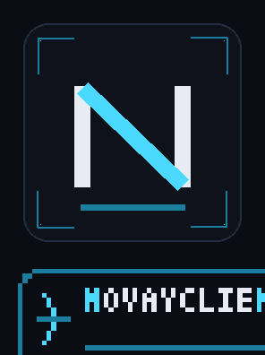

# Novayclient

A client-style **Minecraft Bedrock resource pack** for **1.19.50.02** (Android
first). Novayclient is not an app, launcher, APK or injected client — it is a
`.mcpack` you import and enable as a resource pack.



| | |
|---|---|
| Edition | Minecraft Bedrock Edition |
| Test target | `1.19.50.02` |
| Pack type | Resource Pack (`resources` module) |
| Manifest | `format_version` 2, `min_engine_version` `[1, 19, 50]` |
| Deliverable | `build/Novayclient_1.0.0.mcpack` |
| Scripts / experiments | none — no behaviour pack, no Beta APIs |

## What it changes

Novayclient 1.0 is a **visual** client layer. It restyles existing HUD and menu
art, plus a few additive UI controls, without touching gameplay.

| Feature | Status | How |
|---|---|---|
| Novay identity, pack icon, palette | Verified asset | original artwork |
| Hotbar slots + selection frame | Verified asset | `textures/ui/hotbar_*`, `selected_hotbar_slot` |
| Hearts, hunger, armor, air, XP bar | Verified asset | vanilla-sized 9x9 / 13x5 / 12x30 sprites |
| Cleaner inventory + container surfaces | Verified asset | nine-sliced `cell_image*`, `dialog_background_opaque` |
| Pause menu frame + brand plate | Experimental (JSON UI) | `pause_screen_border` texture + appended plate |
| Chat row restyle | Experimental (JSON UI) | `chat_grid_item/chat_background` merge |
| In-game identity chip | Experimental (JSON UI) | appended to `hud.root_panel` |
| Crosshair | **Experimental — see below** | `textures/gui/icons.png` atlas cell |
| Low fire | Optional, external build | `tools/make_low_fire.py` |

### The crosshair, stated plainly

In 1.19.50 there is **no crosshair file and no crosshair UI control**. The
first-person reticle is the `(0,0)`–`(15,15)` cell of `textures/gui/icons.png`,
which no JSON UI file references. This pack therefore ships a 16x16
`textures/gui/icons.png` containing only that cell. That is the standard
texture-replacement route and it keeps every other HUD element untouched, but
it could not be verified in game from this environment. It is labelled
**Experimental** until someone confirms it on 1.19.50.02 (see
[docs/TESTING.md](docs/TESTING.md), test C1). Four alternative reticles are
provided in `docs/preview/crosshair_*.png`.

### What it does not do

No FPS, CPS, ping, keystroke, speed or damage-number counters. Those need live
input/frame/network data that a resource pack cannot read on this build, so
shipping them would mean shipping fake numbers. No hitbox or reach changes, no
game-file patching, no performance promises.

## Install

1. Copy `build/Novayclient_1.0.0.mcpack` to the phone.
2. Open it with Minecraft (or **Settings → Global Resources → My Packs**).
3. Activate **Novayclient**. It works in any world without experimental
   toggles and without a behaviour pack.

If another pack also changes the HUD, keep Novayclient **above** it in the pack
list. See [docs/COMPATIBILITY.md](docs/COMPATIBILITY.md).

## Build from source

```bash
python3 -m venv .venv
.venv/bin/pip install pillow

.venv/bin/python tools/gen_assets.py   # regenerate all artwork + previews
python3 tools/build.py                 # validate and package
python3 tools/build.py --check          # validation only (CI)
```

`tools/build.py` parses every JSON file (duplicate keys are fatal), checks the
manifest and UUIDs, proves every texture matches its vanilla canvas size,
checks nine-slice sidecars, and verifies that every UI element this pack merges
really exists in the 1.19.50 reference tree. It refuses to package on failure.

## Documentation

- [docs/FEASIBILITY.md](docs/FEASIBILITY.md) — what a 1.19.50 resource pack can and cannot do, with evidence
- [docs/FEATURES.md](docs/FEATURES.md) — every feature, its status, and how it is implemented
- [docs/COMPATIBILITY.md](docs/COMPATIBILITY.md) — known limits, conflicts, pack ordering
- [docs/TESTING.md](docs/TESTING.md) — the on-device acceptance checklist
- [docs/ACCEPTANCE.md](docs/ACCEPTANCE.md) — blueprint §15 checklist, static vs device status
- [docs/UI_BINDINGS.md](docs/UI_BINDINGS.md) — bindings used, and bindings deliberately not used
- [docs/REFERENCES.md](docs/REFERENCES.md) — sources and how each was used
- [docs/ASSETS.md](docs/ASSETS.md) — asset provenance and regeneration
- [LICENSES.md](LICENSES.md) — licences and third-party material
- [CHANGELOG.md](CHANGELOG.md) — release history

## Repository layout

```text
pack/                 the resource pack itself (this is what gets zipped)
  manifest.json
  pack_icon.png
  ui/                 hud_screen, pause_screen, _global_variables
  textures/ui/        HUD + menu artwork (+ nine-slice .json sidecars)
  textures/gui/       icons.png (crosshair atlas)
  texts/en_US.lang
tools/                asset generator, pack builder/validator, low-fire builder
docs/                 compatibility, testing, feasibility, references, previews
build/                generated .mcpack (ignored by git)
```

No vanilla artwork is redistributed. See [docs/ASSETS.md](docs/ASSETS.md).
